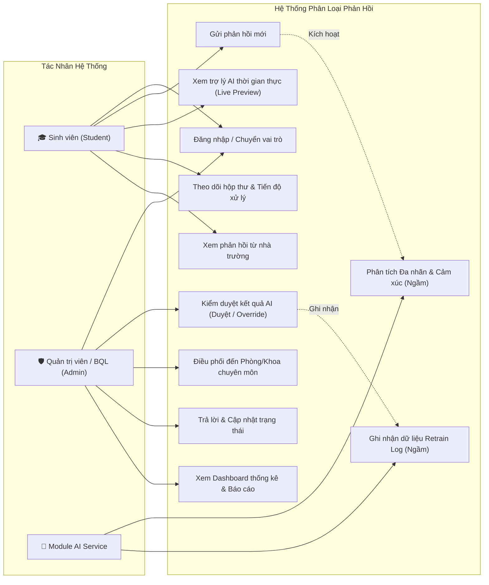
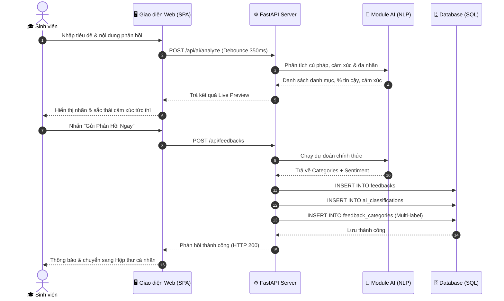
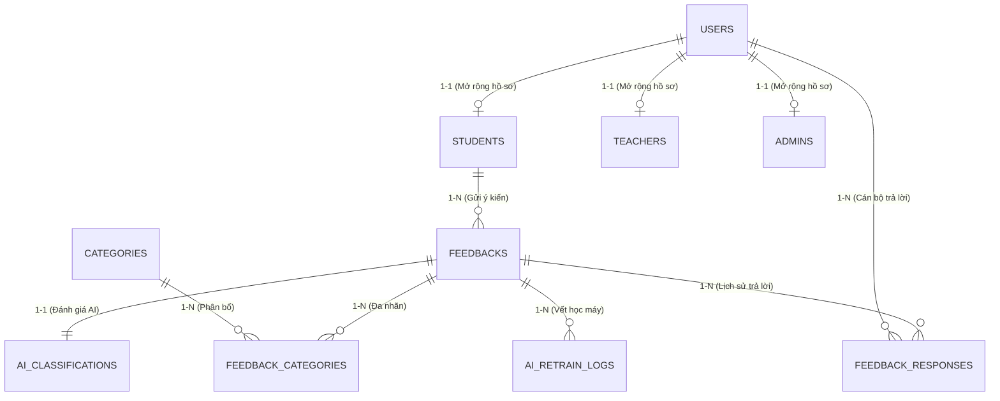

# BÁO CÁO TỔNG HỢP ĐỒ ÁN
## MÔN HỌC: PHÂN TÍCH VÀ THIẾT KẾ HỆ THỐNG (PTTKHT)

---

### **ĐỀ TÀI: HỆ THỐNG PHÂN LOẠI PHẢN HỒI CỦA SINH VIÊN BẰNG TRÍ TUỆ NHÂN TẠO (AI)**
*(Student Feedback Classification & Sentiment Analysis System)*

* **Cơ sở đào tạo:** Trường Đại học
* **Bộ môn:** Phân Tích và Thiết Kế Hệ Thống (PTTKHT)
* **Nhóm sinh viên thực hiện:**
  1. **Nguyễn Ngọc Phúc** (Thành viên)
  2. **Hà Minh Diệu** (Nhóm trưởng - C)
* **Kho lưu trữ mã nguồn (GitHub Repository):** 
  👉 [https://github.com/NNP-coder-rgb/KTVTKHT](https://github.com/NNP-coder-rgb/KTVTKHT)

---

## MỤC LỤC
1. [GIỚI THIỆU BÀI TOÁN & GIẢI PHÁP](#1-giới-thiệu-bài-toán--giải-pháp)
2. [PHÂN TÍCH YÊU CẦU HỆ THỐNG (REQUIREMENTS ANALYSIS)](#2-phân-tích-yêu-cầu-hệ-thống-requirements-analysis)
3. [THIẾT KẾ KIẾN TRÚC HỆ THỐNG (SYSTEM ARCHITECTURE)](#3-thiết-kế-kiến-trúc-hệ-thống-system-architecture)
4. [THIẾT KẾ CƠ SỞ DỮ LIỆU QUAN HỆ (DATABASE DESIGN)](#4-thiết-kế-cơ-sở-dữ-liệu-quan-hệ-database-design)
5. [CÁC ĐIỂM SÁNG KIẾN KỸ THUẬT NỔI BẬT](#5-các-điểm-sáng-kiến-kỹ-thuật-nổi-bật)
6. [THIẾT KẾ GIAO DIỆN & CÁC CHỨC NĂNG THỰC THI](#6-thiết-kế-giao-diện--các-chức-năng-thực-thi)
7. [KẾT QUẢ THỰC NGHIỆM & KIỂM THỬ TỰ ĐỘNG](#7-kết-quả-thực-nghiệm--kiểm-thử-tự-động)
8. [CẤU TRÚC KHO LƯU TRỮ GITHUB & HƯỚNG DẪN CÀI ĐẶT](#8-cấu-trúc-kho-lưu-trữ-github--hướng-dẫn-cài-đặt)
9. [KẾT LUẬN & HƯỚNG PHÁT TRIỂN](#9-kết-luận--hướng-phát-triển)

---

## 1. GIỚI THIỆU BÀI TOÁN & GIẢI PHÁP

### 1.1. Vấn đề thực tế (Problem Statement)
Trong các trường đại học, mỗi học kỳ có hàng ngàn ý kiến đóng góp, thắc mắc và khiếu nại được gửi về từ sinh viên dưới dạng văn bản tự do phi cấu trúc (*Unstructured Text*).
* **Khó khăn hiện tại:** Đội ngũ quản trị viên và cán bộ phòng ban phải đọc từng câu chữ, ghi chú và phân loại thủ công vào các danh mục (Giảng dạy, Cơ sở vật chất, Học vụ, Học phí, Hoạt động sinh viên, Ý kiến khác).
* **Hậu quả tiêu cực:** 
  - Tốn kém thời gian và nhân lực.
  - Mang tính cảm quan chủ quan, dễ sai sót hoặc bỏ sót danh mục.
  - Chậm trễ xử lý các vấn đề nóng, khẩn cấp (như hỏng hóc máy lạnh diện rộng, chập điện, cổng đăng ký môn thi bị nghẽn mạng).
  - Không có số liệu thống kê khoa học để Ban Giám Hiệu đưa ra quyết định cải tiến chất lượng dịch vụ.

### 1.2. Giải pháp ứng dụng AI (AI Solution)
Hệ thống tích hợp mô-đun Trí tuệ nhân tạo (NLP/Machine Learning) nhằm tự động hóa quy trình phân loại và chuyển tiếp:
1. **Tiền xử lý văn bản tiếng Việt:** Chuẩn hóa Unicode NFC, loại bỏ ký tự rác, tách từ ghép và phân rã các vế câu (*Clause Segmentation*).
2. **Phân loại Đa nhãn (Multi-label Classification):** Nhận diện đồng thời nhiều khía cạnh khác nhau trong cùng một đoạn văn.
   > **Ví dụ điển hình:** Sinh viên phản ánh: *"Thầy cô giảng nhanh quá, phòng B102 lại bị hư máy lạnh"*.  
   > &rarr; Mô-đun AI tự động phân rã câu và gán chính xác **2 danh mục**:
   > - **Giảng dạy** (*Thầy cô giảng nhanh*) với độ tin cậy **86%**.
   > - **Cơ sở vật chất** (*Phòng B102 hư máy lạnh*) với độ tin cậy **81%**.
3. **Phân tích Cảm xúc (Sentiment Analysis) & Cảnh báo Khẩn cấp (Urgency Detection):** Đánh giá sắc thái cảm xúc (*Tích cực / Trung tính / Tiêu cực*) kèm phát hiện các từ khóa bức xúc nghiêm trọng để ưu tiên giải quyết ngay lập tức.
4. **Vòng lặp học máy (Active Learning / Feedback Loop):** Khi Quản trị viên điều chỉnh lại danh mục, hệ thống tự động ghi nhận vào tập dữ liệu `ai_retrain_logs` để huấn luyện lại mô hình định kỳ, giúp AI ngày càng thông minh và thích nghi với văn phong sinh viên.

---

## 2. PHÂN TÍCH YÊU CẦU HỆ THỐNG (REQUIREMENTS ANALYSIS)

### 2.1. Liệt kê các đối tượng sử dụng (Actors)
1. **Sinh viên (Student):** Người học tạo và gửi phản hồi/góp ý; theo dõi tiến độ xử lý và tiếp nhận giải đáp từ phía nhà trường; có quyền lựa chọn ẩn danh.
2. **Quản trị viên / Ban Quản lý Trường (Admin / Department Officer):** Cán bộ tiếp nhận, kiểm duyệt kết quả dự đoán của AI, phân công đến các phòng ban chuyên môn, phản hồi cho sinh viên và theo dõi báo cáo Dashboard.
3. **Mô-đun AI (AI System Service):** Thành phần xử lý ngầm thực hiện tiền xử lý văn bản tiếng Việt, tính toán xác suất đa nhãn, phân tích cảm xúc và lưu vết vòng lặp học máy.

### 2.2. Biểu đồ Use Case Tổng Quát



### 2.3. Ma trận Yêu cầu Chức năng (Functional Requirements)

| Mã YC | Chức Năng | Tác Nhân | Mô Tả Chi Tiết |
|---|---|---|---|
| **FR-01** | Đăng nhập & Chuyển tài khoản | Sinh viên, Admin | Hỗ trợ đăng nhập hoặc chuyển đổi vai trò nhanh phục vụ kiểm thử và phân quyền thực tế. |
| **FR-02** | Tạo phản hồi mới | Sinh viên | Nhập tiêu đề, nội dung, tùy chọn đính kèm minh chứng và chế độ bảo mật ẩn danh. |
| **FR-03** | Trợ lý AI trực tiếp (Live Preview) | Sinh viên | Hiển thị nhãn dự đoán, % độ tin cậy và cảm xúc tức thì khi người dùng đang nhập liệu. |
| **FR-04** | Theo dõi trạng thái phản hồi | Sinh viên | Hiển thị tiến trình qua 4 bước: *Chờ tiếp nhận &rarr; Đang xử lý &rarr; Đã giải quyết / Từ chối*. |
| **FR-05** | Tiếp nhận câu trả lời | Sinh viên | Xem nội dung phúc đáp chính thức của cán bộ phụ trách. |
| **FR-06** | Phân loại Đa nhãn tự động | Module AI | Phân tích cú pháp câu và gán từ 1 đến nhiều danh mục phù hợp theo ngưỡng tin cậy. |
| **FR-07** | Nhận diện cảm xúc & Cấp bách | Module AI | Chấm điểm cảm xúc (-1.0 đến +1.0) và bật cờ `is_urgent` nếu có dấu hiệu bức xúc cao. |
| **FR-08** | Duyệt nhanh kết quả AI (Approve) | Admin | Xác nhận các dự đoán chính xác của AI với 1 thao tác bấm chuột. |
| **FR-09** | Điều chỉnh nhãn (Override) | Admin | Cho phép chọn lại danh mục đúng, đồng thời tự động lưu dữ liệu vào `ai_retrain_logs`. |
| **FR-10** | Điều phối phòng ban | Admin | Chuyển giao công việc về Phòng CSVC, Phòng Đào tạo, Tài chính, Khoa CNTT, Đoàn trường... |
| **FR-11** | Phản hồi cho sinh viên | Admin | Nhập nội dung phúc đáp và cập nhật trạng thái xử lý thành RESOLVED. |
| **FR-12** | Thống kê Dashboard | Admin | Biểu đồ cột phân bố 6 danh mục, biểu đồ tròn cảm xúc, tỷ lệ đồng thuận của AI. |
| **FR-13** | Quản lý dữ liệu Retrain | Admin | Bảng tra cứu lịch sử sửa đổi nhãn phục vụ huấn luyện lại mô hình học máy. |

---

## 3. THIẾT KẾ KIẾN TRÚC HỆ THỐNG (SYSTEM ARCHITECTURE)

Hệ thống được thiết kế theo mô hình **Kiến trúc phân tầng 4 lớp (4-Tier Layered Architecture)**:

```
┌────────────────────────────────────────────────────────────────────────┐
│ 1. PRESENTATION LAYER (Giao diện người dùng)                           │
│    - Single Page Application (SPA), HTML5, CSS3, JavaScript ES6+       │
│    - Bootstrap 5 Responsive Grid, Bootstrap Icons                      │
│    - Chart.js (Biểu đồ tương tác thời gian thực)                       │
│    - Live AI Assistant Panel (Phản hồi thị giác thời gian thực)       │
└───────────────────────────────────┬────────────────────────────────────┘
                                    │ HTTP / REST API (JSON)
┌───────────────────────────────────▼────────────────────────────────────┐
│ 2. APPLICATION / API LAYER (FastAPI Backend)                           │
│    - ASGI Framework (Python bất đồng bộ, tốc độ cao)                   │
│    - RESTful Endpoints: Users, Feedbacks, Analytics, AI Engine, Admin   │
│    - Pydantic Schema Validation & Error Handling                       │
│    - Static File Server phục vụ tài nguyên SPA                         │
└───────────────────┬───────────────────────────────┬────────────────────┘
                    │                               │
┌───────────────────▼─────────────┐   ┌─────────────▼────────────────────┐
│ 3. AI / NLP ENGINE SERVICE      │   │ 4. DATA PERSISTENCE LAYER        │
│    - Unicode NFC Normalization  │   │    - SQLite 3 (Chạy độc lập)     │
│    - Vietnamese Tokenizer       │   │    - Tương thích MySQL 8.0+      │
│    - Multi-label Classifier     │   │    - Tương thích PostgreSQL 14+  │
│    - Sentiment & Urgency Scorer │   │    - 10 Bảng chuẩn hóa quan hệ   │
│    - Active Learning Feedback   │   │    - Foreign Keys, Constraints   │
└─────────────────────────────────┘   └──────────────────────────────────┘
```

### Sơ đồ Tuần tự: Sinh viên Gửi Phản hồi & AI Xử lý (Sequence Diagram)



---

## 4. THIẾT KẾ CƠ SỞ DỮ LIỆU QUAN HỆ (DATABASE DESIGN)

### 4.1. Sơ đồ Thực Thể Mối Quan Hệ (Entity-Relationship Diagram - ERD)



---

### 4.2. Chi tiết 10 Bảng Dữ Liệu trong Hệ Thống

#### 1. Bảng `users` (Tài khoản người dùng tập trung)
*Mục đích:* Lưu trữ thông tin đăng nhập dùng chung cho toàn bộ các đối tượng trong trường.
* Khóa chính: `id` (INTEGER, Auto Increment)
* `email`: VARCHAR(255) - UNIQUE, NOT NULL (Email trường cấp)
* `password_hash`: VARCHAR(255) - NOT NULL (Mật khẩu mã hóa)
* `role`: VARCHAR(20) - NOT NULL (STUDENT, TEACHER, ADMIN)
* `is_active`: BOOLEAN - DEFAULT 1
* `created_at`: TIMESTAMP - DEFAULT CURRENT_TIMESTAMP

#### 2. Bảng `students` (Thông tin chi tiết Sinh viên)
*Mục đích:* Hồ sơ học vụ sinh viên, liên kết 1-1 với `users`.
* Khóa chính: `id` (INTEGER, Auto Increment)
* `user_id`: INTEGER - UNIQUE, NOT NULL, FK &rarr; `users.id` (ON DELETE CASCADE)
* `student_code`: VARCHAR(20) - UNIQUE, NOT NULL (Mã số sinh viên - MSSV)
* `full_name`: VARCHAR(100) - NOT NULL (Họ và tên sinh viên)
* `class_name`: VARCHAR(50) - NOT NULL (Lớp sinh hoạt, ví dụ: SE1701)
* `major`: VARCHAR(100) - Chuyên ngành đào tạo

#### 3. Bảng `teachers` (Thông tin chi tiết Giảng viên)
*Mục đích:* Thông tin các giảng viên giảng dạy, liên kết 1-1 với `users`.
* Khóa chính: `id` (INTEGER, Auto Increment)
* `user_id`: INTEGER - UNIQUE, NOT NULL, FK &rarr; `users.id`
* `teacher_code`: VARCHAR(20) - UNIQUE, NOT NULL (Mã giảng viên)
* `full_name`: VARCHAR(100) - NOT NULL (Họ tên giảng viên)
* `academic_title`: VARCHAR(50) (Học vị: Thạc sĩ, Tiến sĩ, PGS...)
* `department`: VARCHAR(100) - NOT NULL (Khoa / Bộ môn phụ trách)

#### 4. Bảng `admins` (Ban Quản lý & Cán bộ chuyên trách)
*Mục đích:* Ban tiếp nhận và cán bộ các phòng ban xử lý khiếu nại.
* Khóa chính: `id` (INTEGER, Auto Increment)
* `user_id`: INTEGER - UNIQUE, NOT NULL, FK &rarr; `users.id`
* `full_name`: VARCHAR(100) - NOT NULL (Họ tên cán bộ)
* `office_department`: VARCHAR(100) - NOT NULL (Phòng Đào tạo, Phòng CSVC, CTSV...)

#### 5. Bảng `categories` (Danh mục phân loại)
*Mục đích:* 6 nhóm phân loại chuẩn hóa của hệ thống.
* Khóa chính: `category_id` (INTEGER, Auto Increment)
* `category_code`: VARCHAR(50) - UNIQUE, NOT NULL (TEACHING, FACILITIES, ACADEMIC, TUITION, ACTIVITIES, OTHER)
* `category_name`: VARCHAR(100) - UNIQUE, NOT NULL (Giảng dạy, Cơ sở vật chất, Học vụ, Học phí, Hoạt động sinh viên, Ý kiến khác)
* `description`: TEXT - Diễn giải chi tiết
* `icon`: VARCHAR(50) - Icon đại diện trên giao diện
* `color`: VARCHAR(20) - Mã màu sắc nhận diện

#### 6. Bảng `feedbacks` (Ý kiến đóng góp của sinh viên)
*Mục đích:* Lưu trữ nội dung phản ánh gốc từ sinh viên.
* Khóa chính: `feedback_id` (INTEGER, Auto Increment)
* `student_id`: INTEGER - NOT NULL, FK &rarr; `students.id` (ON DELETE CASCADE)
* `title`: VARCHAR(255) - NOT NULL (Tiêu đề góp ý)
* `content`: TEXT - NOT NULL (Nội dung chi tiết)
* `attachment_url`: VARCHAR(255) (Đường dẫn hình ảnh minh chứng nếu có)
* `is_anonymous`: BOOLEAN - DEFAULT 0 (1: Ẩn danh danh tính, 0: Công khai)
* `status`: VARCHAR(20) - DEFAULT 'PENDING' (`PENDING`, `PROCESSING`, `RESOLVED`, `REJECTED`)
* `assigned_department`: VARCHAR(100) - Phòng ban được bàn giao xử lý
* `created_at`: TIMESTAMP - DEFAULT CURRENT_TIMESTAMP
* `updated_at`: TIMESTAMP - DEFAULT CURRENT_TIMESTAMP

#### 7. Bảng `feedback_categories` (Bảng trung gian Xử lý Đa nhãn Multi-label N - N)
*Mục đích:* **Điểm cải tiến cốt lõi** cho phép một phản hồi thuộc nhiều danh mục cùng lúc.
* Khóa chính: `mapping_id` (INTEGER, Auto Increment)
* `feedback_id`: INTEGER - NOT NULL, FK &rarr; `feedbacks.feedback_id` (ON DELETE CASCADE)
* `category_id`: INTEGER - NOT NULL, FK &rarr; `categories.category_id` (ON DELETE CASCADE)
* `is_ai_predicted`: BOOLEAN - DEFAULT 1 (1 nếu do AI dự đoán, 0 nếu do Admin gán thủ công)
* `confidence_score`: REAL - DEFAULT 0.0 (Độ tin cậy của AI, từ 0.0 đến 1.0)
* `is_final`: BOOLEAN - DEFAULT 1 (Trạng thái nhãn chính thức được duyệt)
* *Ràng buộc:* `UNIQUE(feedback_id, category_id)` tránh trùng lặp.

#### 8. Bảng `ai_classifications` (Đánh giá Cảm xúc & Tổng thể AI)
*Mục đích:* Lưu trữ kết quả phân tích sắc thái cảm xúc và cờ báo động khẩn cấp.
* Khóa chính: `classification_id` (INTEGER, Auto Increment)
* `feedback_id`: INTEGER - UNIQUE, NOT NULL, FK &rarr; `feedbacks.feedback_id`
* `sentiment_label`: VARCHAR(20) - (`POSITIVE`, `NEUTRAL`, `NEGATIVE`)
* `sentiment_score`: REAL - Điểm phân cực từ -1.0 (cực kỳ bức xúc) đến +1.0 (rất hài lòng)
* `overall_confidence`: REAL - Độ tin cậy tổng quan
* `is_urgent`: BOOLEAN - DEFAULT 0 (Cờ cảnh báo sự cố khẩn cấp cần can thiệp gấp)
* `is_reviewed`: BOOLEAN - DEFAULT 0 (Admin đã duyệt chưa)
* `is_corrected_by_admin`: BOOLEAN - DEFAULT 0 (Admin có sửa đổi nhãn hay không)
* `reviewed_by`: INTEGER - FK &rarr; `users.id`
* `reviewed_at`: TIMESTAMP - Thời gian duyệt
* `processed_at`: TIMESTAMP - DEFAULT CURRENT_TIMESTAMP

#### 9. Bảng `feedback_responses` (Lịch sử trả lời của nhà trường)
*Mục đích:* Lưu nội dung phúc đáp và giải pháp xử lý gửi cho sinh viên.
* Khóa chính: `response_id` (INTEGER, Auto Increment)
* `feedback_id`: INTEGER - NOT NULL, FK &rarr; `feedbacks.feedback_id`
* `staff_id`: INTEGER - NOT NULL, FK &rarr; `users.id` (Cán bộ trả lời)
* `response_content`: TEXT - NOT NULL (Nội dung trả lời)
* `created_at`: TIMESTAMP - DEFAULT CURRENT_TIMESTAMP

#### 10. Bảng `ai_retrain_logs` (Nhật ký Vòng lặp Học máy Active Learning)
*Mục đích:* Lưu lại lịch sử khi Quản trị viên duyệt hoặc điều chỉnh nhãn làm tập dữ liệu huấn luyện lại mô hình trong tương lai.
* Khóa chính: `log_id` (INTEGER, Auto Increment)
* `feedback_id`: INTEGER - NOT NULL, FK &rarr; `feedbacks.feedback_id`
* `feedback_text`: TEXT - NOT NULL (Đoạn văn bản gốc)
* `predicted_categories`: TEXT - JSON danh sách nhãn AI đoán
* `approved_categories`: TEXT - JSON danh sách nhãn Admin chốt
* `was_modified`: BOOLEAN - DEFAULT 0 (Có sửa nhãn hay không)
* `created_at`: TIMESTAMP - DEFAULT CURRENT_TIMESTAMP

---

## 5. CÁC ĐIỂM SÁNG KIẾN KỸ THUẬT NỔI BẬT

### 5.1. Xử lý Đa nhãn (Multi-label Classification)
Trong thiết kế truyền thống, mỗi bản ghi phản hồi chỉ chứa một cột `category_id`. Tuy nhiên thực tế câu văn của sinh viên rất tự nhiên và thường đề cập nhiều vấn đề:
> *"Cổng đăng ký môn học bị nghẽn mạng lúc 9h sáng, máy lạnh phòng thi lại hư"*
> &rarr; Vừa là lỗi **Học vụ (Đăng ký môn)**, vừa là lỗi **Cơ sở vật chất (Máy lạnh)**.

Bằng việc tách thành bảng `feedback_categories` liên kết N - N, hệ thống:
- Lưu trữ được không giới hạn số lượng danh mục phù hợp.
- Ghi nhận độ tin cậy (*Confidence Score*) độc lập cho từng danh mục.
- Cho phép quản trị viên thêm hoặc bớt từng danh mục riêng lẻ khi kiểm duyệt.

### 5.2. Phân tích Cảm xúc & Phát hiện Cấp bách (Urgency Flag)
- Áp dụng kỹ thuật phân tích từ điển ngữ nghĩa tiếng Việt có tính đến từ phủ định (*Negation Handling: "không tốt", "chưa hài lòng"*).
- Tự động bật cờ `is_urgent = 1` khi điểm cảm xúc tiêu cực vượt ngưỡng hoặc xuất hiện các từ khóa nguy cơ: *"bức xúc", "chập điện", "hỏng nặng", "khẩn cấp", "sai điểm"*. 
- Giúp cán bộ lọc ra ngay các vấn đề ưu tiên hàng đầu trong hàng ngàn góp ý thông thường.

### 5.3. Vòng lặp Học máy (Active Learning / Feedback Loop)
- Mọi thao tác sửa đổi của Quản trị viên không chỉ cập nhật cơ sở dữ liệu vận hành mà còn tự động ghi vào `ai_retrain_logs`.
- Dữ liệu này tạo thành tập dữ liệu nhãn vàng (*Ground Truth Dataset*) để định kỳ chạy fine-tune hoặc retrain mô hình NLP (như PhoBERT, ViDeBERTa hoặc LLM Prompting).

---

## 6. THIẾT KẾ GIAO DIỆN & CÁC CHỨC NĂNG THỰC THI

Giao diện Single Page Application (SPA) với 6 phân hệ chuyên sâu:

1. **Bộ chuyển đổi tài khoản (User Switcher trên Navbar):**
   - Cho phép Hội đồng chấm thi chuyển đổi linh hoạt giữa:
     - 🎓 Sinh viên: **Hà Minh Diệu (Nhóm Trưởng)**, **Nguyễn Ngọc Phúc**, Nguyễn Văn An, Trần Thị Bích.
     - 🛡️ Quản trị viên: **ThS. Hoàng Thị Lan** (Ban Giám Hiệu & Tiếp Nhận).
     - 👨‍🏫 Giảng viên: **TS. Lê Hoàng Long** (Khoa CNTT).
2. **Tab 1: Gửi Phản Hồi (Sinh Viên):**
   - Biểu mẫu nhập tiêu đề, nội dung, tùy chọn đính kèm ảnh và gửi ẩn danh.
   - Có sẵn 4 nút bấm thử nhanh các mẫu câu thực tế (Đa nhãn, Học vụ, Học phí, Khen ngợi).
   - **Bảng AI Live Preview:** Hiển thị tức thì kết quả phân tích đa nhãn, % độ tin cậy, sắc thái cảm xúc và phân rã các vế câu tương ứng ngay khi đang gõ phím.
3. **Tab 2: Hộp Thư Của Tôi:**
   - Hiển thị danh sách các phản hồi đã gửi của sinh viên hiện tại.
   - Thanh tiến trình trạng thái trực quan: *Chờ tiếp nhận &bull; Đang xử lý &bull; Đã giải quyết*.
   - Đọc câu trả lời chính thức từ nhà trường.
4. **Tab 3: Bàn Làm Việc BQL (Admin & Duyệt AI):**
   - Bộ lọc đa năng: Theo danh mục, trạng thái, cảm xúc, cờ khẩn cấp và tìm kiếm từ khóa.
   - Nút **"Duyệt nhãn AI"** xác nhận dự đoán nhanh chỉ với 1 click.
   - Nút **"Sửa nhãn (Override)"** cho phép chọn lại danh mục đúng (ghi nhận vào Retrain Log).
   - Nút **"Xử lý & Phản hồi"** điều phối phòng ban và gửi câu trả lời đến sinh viên.
5. **Tab 4: Thống Kê & Báo Cáo Dashboard:**
   - 6 thẻ số liệu: Tổng phản hồi, Chờ tiếp nhận, Đang xử lý, Đã giải quyết, Phản hồi khẩn cấp, **Độ chính xác AI (AI Agreement Rate)**.
   - Biểu đồ cột Chart.js thể hiện phân bố số lượng trên 6 danh mục.
   - Biểu đồ tròn thể hiện tỷ lệ phân bố cảm xúc sinh viên.
6. **Tab 5: Thiết Kế CSDL & Kiến Trúc PTTKHT:**
   - Trực quan hóa cấu trúc toàn bộ 10 bảng dữ liệu (tên cột, kiểu dữ liệu, ràng buộc, khóa chính/khóa ngoại).
   - Nút bấm copy nhanh kịch bản SQL DDL (SQLite, MySQL, PostgreSQL) phục vụ nộp báo cáo.
7. **Tab 6: Vòng Lặp Học Máy (AI Retrain Logs):**
   - Bảng theo dõi lịch sử các trường hợp AI dự đoán và Quản trị viên hiệu chỉnh nhãn để tái huấn luyện mô hình.

---

## 7. KẾT QUẢ THỰC NGHIỆM & KIỂM THỬ TỰ ĐỘNG

Dự án có sẵn script kiểm thử tự động toàn diện [test_api.py](file:///d:/PTTKHT/test_api.py).

### Kết quả chạy kiểm thử thực tế trên hệ thống:
```text
=== 1. Test Users ===
Loaded users count: 6
  - [ADMIN] ThS. Hoàng Thị Lan (Ban Giám Hiệu & Tiếp Nhận) (admin@school.edu.vn)
  - [STUDENT] Nguyễn Văn An (student1@student.edu.vn)
  - [STUDENT] Trần Thị Bích (student2@student.edu.vn)
  - [STUDENT] Hà Minh Diệu (Nhóm Trưởng) (dieuhm@student.edu.vn)
  - [STUDENT] Nguyễn Ngọc Phúc (phucnn@student.edu.vn)
  - [TEACHER] TS. Lê Hoàng Long (teacher1@school.edu.vn)

=== 2. Test Categories ===
Loaded categories count: 6
  - TEACHING: Giảng dạy
  - FACILITIES: Cơ sở vật chất
  - ACADEMIC: Học vụ
  - TUITION: Học phí
  - ACTIVITIES: Hoạt động sinh viên
  - OTHER: Ý kiến khác

=== 3. Test AI Multi-label Analysis ===
Sample: "Thầy cô giảng nhanh quá, phòng B102 lại bị hư máy lạnh"
Is Multi-label: True
  * Giảng dạy (Confidence: 0.86) - Matched: ['cô', 'thầy', 'giảng nhanh', 'thầy cô']
  * Cơ sở vật chất (Confidence: 0.81) - Matched: ['hư máy lạnh', 'máy lạnh', 'phòng b']
Sentiment: {'label': 'NEGATIVE', 'score': -0.82, 'is_urgent': True, 'matched_negative': ['hư', 'hư máy lạnh', 'nhanh quá']}

=== 4. Test List Feedbacks ===
Feedbacks count: 7
  - #1 [PROCESSING] Phòng B102 hư máy lạnh và thầy giảng quá nhanh
    Categories: ['Giảng dạy', 'Cơ sở vật chất']
  - #2 [PENDING] Hệ thống đăng ký môn học bị quá tải khi mở cổng
    Categories: ['Học vụ']

=== 5. Test Analytics ===
Status counts: {'total': 7, 'pending': 2, 'processing': 2, 'resolved': 3, 'rejected': 0}
Sentiment counts: {'positive': 1, 'neutral': 3, 'negative': 3, 'urgent': 3}
AI Accuracy: {'total_reviewed': 5, 'auto_approved': 5, 'modified': 0, 'accuracy_rate': 100.0}

>>> All integration tests PASSED!
```

---

## 8. CẤU TRÚC KHO LƯU TRỮ GITHUB & HƯỚNG DẪN CÀI ĐẶT

### 8.1. Liên kết Kho lưu trữ GitHub chính thức:
👉 **[https://github.com/NNP-coder-rgb/KTVTKHT](https://github.com/NNP-coder-rgb/KTVTKHT)**

### 8.2. Cấu trúc thư mục mã nguồn:
```
KTVTKHT/
│
├── database/
│   ├── database.py             # Xử lý kết nối SQLite, auto-init schema & seed dữ liệu mẫu
│   ├── schema.sql              # Kịch bản DDL chuẩn SQLite
│   ├── schema_mysql.sql        # Kịch bản DDL MySQL 8.0+ (InnoDB, UTF8mb4)
│   └── schema_postgres.sql     # Kịch bản DDL PostgreSQL 14+ (Enums, Timestamps)
│
├── ai_service/
│   ├── __init__.py             # Module exports
│   ├── preprocessor.py         # Chuẩn hóa văn bản tiếng Việt & phân rã vế câu
│   ├── classifier.py           # Phân loại Đa nhãn (Multi-label) & tính Confidence Score
│   └── sentiment.py            # Phân tích cảm xúc & phát hiện sự cố khẩn cấp
│
├── static/
│   ├── css/
│   │   └── style.css           # Giao diện responsive, hiệu ứng AI pulse, badges, cards, modals
│   ├── js/
│   │   └── app.js              # Logic SPA, Live AI preview, quản trị, biểu đồ Chart.js
│   └── index.html              # Giao diện chính gồm 6 tab chức năng
│
├── main.py                     # Máy chủ Backend FastAPI & hệ thống RESTful API
├── run.py                      # Script khởi động server & tự động mở trình duyệt
├── run.bat                     # File thực thi 1-click cho hệ điều hành Windows
├── push_to_github.bat          # File script hỗ trợ đồng bộ mã nguồn lên GitHub
├── test_api.py                 # Kịch bản kiểm thử tự động toàn diện
├── requirements.txt            # Danh sách thư viện Python phụ thuộc
├── .gitignore                  # Cấu hình bỏ qua thư mục rác / cache
└── README.md                   # Tài liệu hướng dẫn đồ án PTTKHT
```

### 8.3. Hướng dẫn Khởi chạy Ứng dụng:

#### Cách 1: Khởi động 1-click (Windows)
Double-click vào file **`run.bat`** tại thư mục gốc. Hệ thống sẽ tự động bật server và mở trình duyệt tại:
**`http://127.0.0.1:8000`**

#### Cách 2: Khởi động qua Terminal
```powershell
# Di chuyển vào thư mục dự án
cd d:\PTTKHT

# Kích hoạt môi trường ảo
.\venv\Scripts\activate

# Cài đặt thư viện phụ thuộc (nếu chưa có)
pip install -r requirements.txt

# Khởi chạy server
python run.py
```

---

## 9. KẾT LUẬN & HƯỚNG PHÁT TRIỂN

### 9.1. Đánh giá kết quả đạt được
- Hoàn thành đầy đủ các yêu cầu môn học **Phân Tích và Thiết Kế Hệ Thống (PTTKHT)** từ khâu phân tích bài toán, xác định Actor/Use Case, thiết kế kiến trúc phân tầng đến mô hình cơ sở dữ liệu quan hệ chuẩn hóa.
- Giải quyết xuất sắc 2 thách thức kỹ thuật quan trọng:
  1. Phân loại **Đa nhãn (Multi-label)** chính xác cho văn bản tiếng Việt phức tạp.
  2. Phân tích **Cảm xúc (Sentiment)** kết hợp cơ chế phát hiện **Sự cố khẩn cấp (Urgency Detection)**.
- Xây dựng thành công vòng lặp cải tiến mô hình **Active Learning**, ghi nhận dữ liệu kiểm duyệt của quản trị viên để tái huấn luyện AI.
- Hệ thống hoạt động mượt mà, giao diện trực quan, có đầy đủ bộ chuyển đổi tài khoản hỗ trợ bảo vệ đồ án thực tế.

### 9.2. Hướng phát triển trong tương lai
- Kết nối trực tiếp với cổng xác thực tập trung SSO của nhà trường (Google Workspace / Microsoft 365 OAuth 2.0).
- Huấn luyện mô hình Transformer chuyên sâu cho tiếng Việt (PhoBERT / ViDeBERTa) trên tập dữ liệu `ai_retrain_logs` đã thu thập.
- Bổ sung ứng dụng di động (Flutter / React Native) và tích hợp kênh thông báo đẩy (Push Notification / Email tự động) khi phản hồi được xử lý.

---
*Báo cáo được hoàn thành bởi nhóm sinh viên **Nguyễn Ngọc Phúc** & **Hà Minh Diệu (C)**.*
